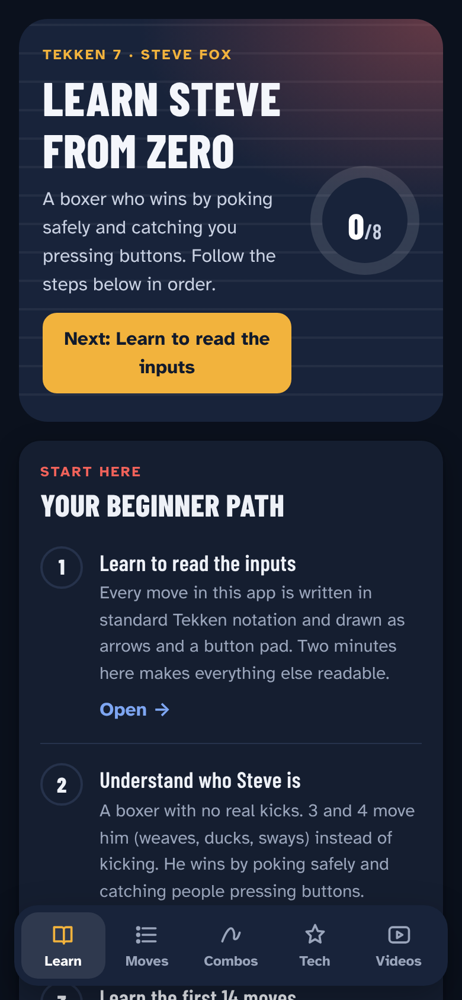
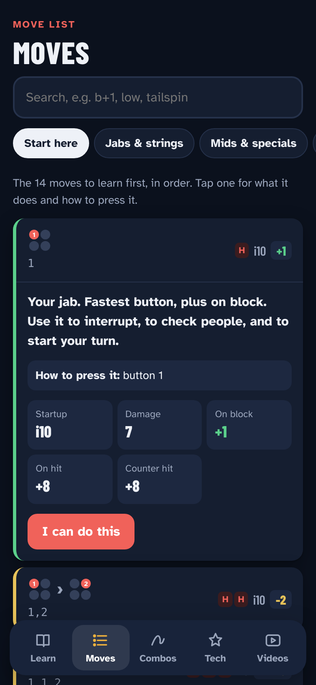
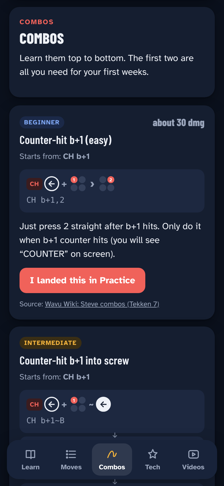
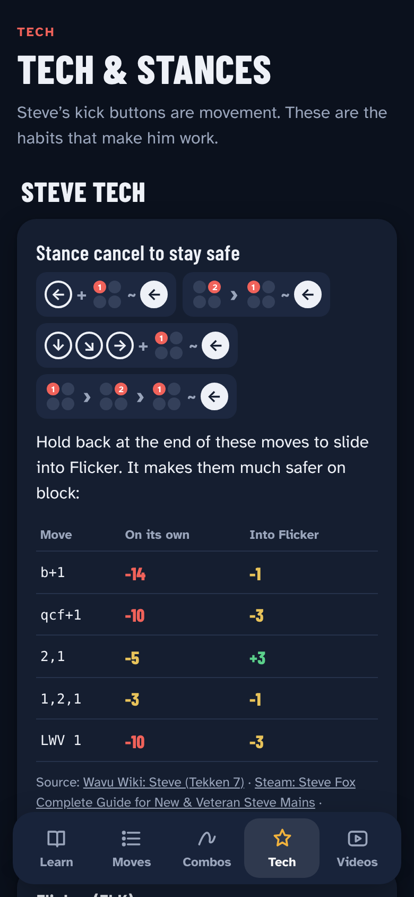

# Peekaboo

A phone-first **Tekken 7 Steve Fox** guide for complete beginners: a move list with frame data, punishers, combos, Steve's stance tech, and the best video guides, all in one place.

*Peekaboo* is named after one of Steve's stances. The app is strictly Tekken 7 (not Tekken 8) and strictly Steve.

**Open the app:** https://Darrie-Andrei-Dizon.github.io/peekaboo/

| Learn | Moves | Combos | Tech |
| --- | --- | --- | --- |
|  |  |  |  |

## What it does

**Starting from zero**
- **A beginner path** of 8 steps, in order: read the inputs, understand Steve, learn the first 14 moves, 4 punishers, one combo, the game plan, stance tech, then watch the basics video. Tick each off as you go.
- **Inputs you can read at a glance.** Every move is drawn as arrows (filled when you hold the direction) and a 1-2-3-4 button pad, with a plain-English line like "hold back and button 1".
- **Notation and frame data explained** in two short lists, so `d/f+1`, `~B`, `i13` and `-14` all make sense.

**Steve**
- **Who Steve is:** strengths and weaknesses in Tekken 7.
- **The game plan** as five habits: poke, frame trap, stay safe with stances, open them up, punish everything. Plus the common beginner mistakes, like spamming b+1.
- **Move list** of 100+ moves and strings, grouped by stance (Flicker, Peekaboo, Duck, Weaves, Sway, Albatross), searchable, with startup, damage, and frames on block, hit and counter hit. Block frames are coloured plus, safe or punishable.
- **Punishers** by how negative the opponent's move was (-10, -12, -13, -15, after a low, whiff).
- **Combos** from easy to advanced: counter-hit b+1, the bread-and-butter, wall-carry enders and a consistent wall option, with a practice routine.
- **Tech:** stance cancels that make moves safe (with before-and-after frames), Flicker, Peekaboo, Duck, weaves, sway, parry, power crushes and Rage Drive, plus Tekken 7 basics like backdashing, sidestepping, throw breaks and Punishment Training.
- **Video guides:** Tekken 7 Steve guides on YouTube, ordered beginner to deep dive, playable right in the app. The two-hour Complete Breakdown has chapter buttons.

**Your progress**
- Mark moves as learned and combos as landed. Progress stays on your phone (localStorage). No account.
- Works offline once loaded (videos need a connection) and installs to your home screen.

## Where the strategy comes from

Nothing here is made up from scratch. Each section cites its sources in the app:

- **Frame data:** [RBNorway Steve T7 frame data](https://rbnorway.org/steve-t7-frames/), via the open-source [mokujin](https://github.com/BKNR/mokujin) Tekken 7 bot's copy (Season 4, March 2021). The final v5 patch may have changed a few numbers; check with the in-game Frame Data Display.
- **Game plan, key moves and weaknesses:** [Wavu Wiki: Steve (Tekken 7)](https://wavu.wiki/t/Steve_(Tekken_7)), [Overview and Guide for Steve](https://tekken7combo.kagewebsite.com/guide/overview-guide-steve), [SaltyEU Steve Guide](https://www.salty-eu.com/en/news/details/steve-guide), and the [Steve Fox Complete Guide on Steam](https://steamcommunity.com/sharedfiles/filedetails/?id=2220893473).
- **Punishers and combos:** [TekkenDocs Steve T7](https://tekkendocs.com/t7/steve/meta), [Wavu Wiki: Steve combos (Tekken 7)](https://wavu.wiki/t/Steve_combos_(Tekken_7)), [DashFight](https://dashfight.com/news/tekken-7-steve-fox-guide-combos-and-move-list-263), and the guides above.
- **Videos:** community Tekken 7 Steve guides on YouTube, including *STEVE Basic Guide (Basic to Pro)*, *Steve PRACTICAL Guide – Beginner to KOREAN Series*, *STEVE GUIDE (Punish & Oki)*, *Steve Fox Combo Guide (Season 4)* and *Steve Fox Complete Breakdown*.

Combos are listed the way these guides write them. Always try a combo in Practice mode before relying on it: timing and wall distance matter.

## Put it on GitHub Pages

1. Go to **Settings → Pages**. Under **Build and deployment**, choose **Deploy from a branch**, branch **main**, folder **/ (root)**, then **Save**.
2. After a minute the app is live at `https://YOUR-USERNAME.github.io/peekaboo/`.
3. On your phone, open that link and choose **Add to Home Screen** (Safari share menu, or Chrome's ⋮ menu).

## Run it on your computer

The app uses JavaScript modules, so it needs a local server rather than opening `index.html` directly:

```bash
python3 -m http.server 8000
```

Then open http://localhost:8000.

## How it's built

Plain HTML, CSS and JavaScript with no build step.

| File | What it holds |
| --- | --- |
| `index.html` | Page shell and bottom navigation |
| `css/app.css` | All styles, light and dark |
| `js/app.js` | Screens and actions |
| `js/notation.js` | Notation parser and the arrow-and-button-pad renderer (pure functions) |
| `js/moves.js` | Steve's move list and frame data |
| `js/guide.js` | Beginner path, game plan, tech, punishers, combos, videos and sources |
| `tests/data.test.mjs` | Checks the notation parser and the guide data. Run `node tests/data.test.mjs` |
| `sw.js` | Offline caching |

### After changing files

Bump `CACHE` in `sw.js` (for example `peekaboo-v2`) so phones pick up the new version.

## Credits

Built with Claude (Anthropic) as a vibe-coded project. An unofficial fan guide: Tekken and Steve Fox belong to Bandai Namco Entertainment. Frame data by RBNorway; strategy from the community guides and videos linked above.
